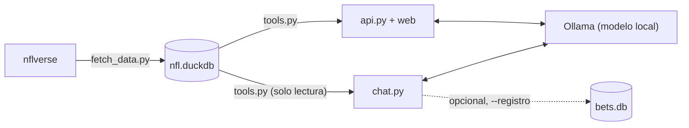

<div align="center">

# NFL Local

**Un analista de estadísticas de la NFL que corre en tu PC. Datos reales, un modelo local y cero números inventados.**

[](https://www.python.org/)
[](https://duckdb.org/)
[](https://ollama.com/)
[](https://fastapi.tiangolo.com/)
[-013369)](https://nflreadr.nflverse.com/)

[English](README.md) · **Español**

</div>

---

NFL Local guarda los datos de [nflverse](https://nflreadr.nflverse.com/) en una base **DuckDB** local, y un
**modelo local de Ollama** responde tus preguntas llamando herramientas que consultan esa base. También incluye una
página web con un reporte de cada juego.

> [!IMPORTANT]
> **El modelo solo te da estadísticas para que _tú_ decidas.** No apuesta, no te dice qué lado tomar y nunca dice
> que algo es "seguro". Todos los números salen de tu base, no de la imaginación del modelo.

## Características

- **Todo corre en tu equipo.** Sin nube, sin API keys de pago, sin suscripciones. La web también funciona sin internet.
- **Usa herramientas, no adivina.** El modelo llama herramientas de solo lectura (`game_report`, `compare_teams`, `run_sql`...) y cita lo que devuelven.
- **Reportes de juego.** Línea del mercado, probabilidad de victoria sin el margen de la casa, días de descanso, QB listados, forma reciente (récord, ATS, over/under, EPA, entregas), base histórica de líneas parecidas y últimos enfrentamientos.
- **SQL seguro.** Las consultas del modelo corren en una conexión de solo lectura, sin acceso a archivos, una sentencia `SELECT` a la vez y con un límite de 15 segundos.
- **Página web.** Los juegos de la semana con la probabilidad del mercado, gráficas por juego y un chat que sabe qué juego estás viendo.
- **Registro de apuestas opcional.** Lleva el control de *tus* apuestas: récord, ROI y CLV. Viene apagado, y el modelo pide confirmación antes de escribir algo.

## Arquitectura



| Archivo | Qué hace |
|---|---|
| `fetch_data.py` | Descarga los datos de nflverse y arma las tablas `team_games` y `games` |
| `tools.py` | Las herramientas de solo lectura que puede usar el modelo |
| `chat.py` | El chat en terminal con Ollama |
| `api.py` + `static/` | El backend en FastAPI y la página web |
| `bets.py` | El registro personal de apuestas, opcional (SQLite, separado de la base de estadísticas) |

## Inicio rápido

**Requisitos:** Python 3.10 o más nuevo y [Ollama](https://ollama.com/download).

```bash
# 1. Descarga un modelo que soporte tool calling
ollama pull granite4.2:8b

# 2. Prepara el entorno
python -m venv .venv
.venv\Scripts\Activate.ps1        # Windows (PowerShell)
# source .venv/bin/activate       # macOS / Linux
pip install -r requirements.txt

# 3. Descarga los datos (de 2021 a hoy; pasa un año para empezar antes)
python fetch_data.py

# 4. Prueba las herramientas sin el modelo
python tools.py

# 5a. Chatea en la terminal...
python chat.py

# 5b. ...o abre la página web en http://127.0.0.1:8000
uvicorn api:app --reload
```

> [!TIP]
> Si PowerShell bloquea `Activate.ps1`, ejecuta una vez `Set-ExecutionPolicy -Scope CurrentUser RemoteSigned`, o
> usa `.venv\Scripts\python.exe` en lugar de `python`.

> [!TIP]
> Corre `python fetch_data.py` cada semana, de preferencia el domingo en la noche o el lunes, para traer los
> marcadores nuevos y las líneas de la semana siguiente. Tu registro de apuestas no se toca: vive en otro archivo.

## Preguntas de ejemplo

| Tú preguntas | El modelo usa |
|---|---|
| *Dame el reporte del juego de BUF* | `game_report` |
| *¿Qué juegos hay esta semana y qué probabilidad les da el mercado?* | `upcoming_games` |
| *Compara a KC y BUF en sus últimos 5 juegos* | `compare_teams` |
| *¿Qué probabilidad implica una cuota de -130?* | `implied_probability` |
| *¿Qué equipos anotaron más puntos por juego en 2025?* | `get_schema` → `run_sql` |

Verás una línea `[herramienta] ...` por cada herramienta que llame el modelo. Si inventa cifras sin llamar nada, o
escribe SQL roto una y otra vez, ese modelo es muy chico para esto: prueba uno más grande.

Más ejemplos y la rutina de cada semana están en la [guía de uso](GUIA_USO.md).

## Elegir modelo

```bash
python chat.py gemma4:e4b          # solo para esta sesión
$env:NFL_MODEL="gemma4:e4b"        # Windows (PowerShell)
export NFL_MODEL=gemma4:e4b        # macOS / Linux
```

| Modelo | RAM aprox. | Tool calling |
|---|---|---|
| `granite4.2:3b` | ~3 GB | básico |
| `phi4-mini` | ~4 GB | básico |
| `granite4.2:8b` *(por defecto)* | ~6 GB | bueno |
| `gemma4:e4b` | ~4 GB | bueno |
| `qwen3.5:9b` | ~8 GB | muy bueno |
| `gpt-oss:20b` | ~14 GB | excelente |
| `mistral-small3.2` | ~18 GB | muy bueno |

`chat.py` fija `num_ctx` en 8192 para ahorrar RAM; súbelo en `OPTIONS` si lo necesitas.

## Modelo de datos

**`team_games`**: una fila por equipo y juego jugado. Puntos, yardas, EPA, entregas, capturas y castigos, más las
líneas desde el punto de vista del equipo: `team_spread` (-3.5 = favorito por 3.5), `ats_result`
(COVER / NO_COVER / PUSH), `total_line` y `ou_result`.

**`games`**: una fila por juego, jugado o por jugar. `spread_line` (**positivo = el local es favorito**),
`total_line`, moneylines, `market_home_prob` (probabilidad de que gane el local, sin el margen de la casa),
`ats_winner` y `ou_result`.

## Opcional: registro personal de apuestas

```bash
python chat.py --registro    # activa log_bet, set_closing_odds, settle_open_bets y bet_summary
python bets.py               # resumen sin abrir el chat
python bets.py selftest      # prueba con una base temporal
```

Las apuestas se guardan en `bets.db` (SQLite), aparte de `nfl.duckdb`, así que actualizar los datos nunca las
borra. El modelo solo anota algo si se lo pides, y cada escritura necesita que confirmes con `s/N` en la terminal.
En `log_bet`, `line` es el spread **del equipo apostado** (-3.5 si es favorito, +3.5 si es underdog) o el total en
over/under; las cuotas van en formato americano.

> [!NOTE]
> El chat web solo tiene las herramientas de lectura. Las del registro piden confirmación en la terminal, así que
> solo funcionan ahí.

## Consideraciones sobre el mercado

La línea de las casas ya incorpora gran parte de lo que muestran estas estadísticas. Al inicio de la temporada las
muestras son chicas, y las diferencias pequeñas frente a 50% suelen ser ruido. Con cuotas de -110 necesitas ganar
~52.4% solo para no perder. Este proyecto te da **tendencias, no certezas**: úsalo para informarte, no como oráculo.

## Hoja de ruta

- [ ] Datos por jugada (`load_pbp`) para EPA por jugada y success rate
- [ ] Reportes de lesiones (`load_injuries`) y el QB titular confirmado
- [ ] Un modelo de probabilidades propio (regresión logística / XGBoost) comparado contra `market_home_prob`
- [ ] Hacerle fine-tuning a un modelo chico con este esquema, si el SQL falla seguido

## Créditos y licencia

- Datos de la NFL de **[nflverse](https://github.com/nflverse)** vía [`nflreadpy`](https://github.com/nflverse/nflreadpy), con licencia **CC-BY 4.0**.
- Librerías incluidas en la web: [Chart.js](https://www.chartjs.org/) (MIT), [marked](https://marked.js.org/) (MIT) y [DOMPurify](https://github.com/cure53/DOMPurify) (Apache-2.0 / MPL-2.0).
- No está afiliado con la NFL. Es solo para fines informativos y educativos. Si apuestas, hazlo con responsabilidad.
