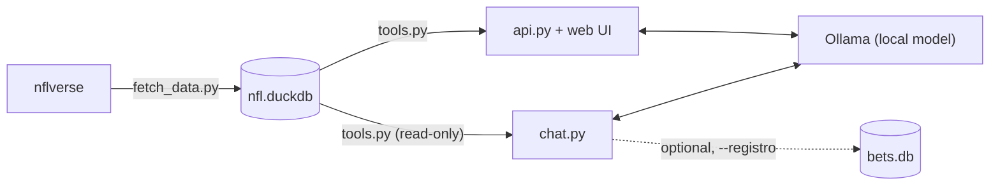

<div align="center">

# NFL Local

**A local NFL stats analyst. Real data, a local LLM, zero made-up numbers.**

[](https://www.python.org/)
[](https://duckdb.org/)
[](https://ollama.com/)
[](https://fastapi.tiangolo.com/)
[-013369)](https://nflreadr.nflverse.com/)

**English** · [Español](README.es.md)

</div>

---

NFL Local pulls data from [nflverse](https://nflreadr.nflverse.com/) into a local **DuckDB** database and lets a
**local Ollama model** answer your questions by calling tools against that database. It also includes a web
dashboard with a report for each game.

> [!IMPORTANT]
> **The model gives you statistics so _you_ can decide.** It doesn't bet, doesn't pick sides and never calls
> anything a "lock". Every number comes from your database, not from the model's imagination.

## Features

- **Everything runs on your machine.** No cloud, no paid API keys, no subscriptions. The web UI works offline too.
- **Tool calling, not guessing.** The model calls read-only tools (`game_report`, `compare_teams`, `run_sql`...) and quotes their output.
- **Game reports.** Market line, no-vig win probability, rest days, listed QBs, recent form (record, ATS, over/under, EPA, turnovers), historical base rates for similar lines and head-to-head results.
- **Safe SQL.** Model-written queries run on a read-only connection with filesystem access disabled, one `SELECT` at a time, with a 15 s timeout.
- **Web dashboard.** This week's games with market probabilities, per-game charts, and a built-in chat that knows which game you're looking at.
- **Optional bet log.** Track your *own* bets: record, ROI and closing line value (CLV). Off by default, and the model asks for confirmation before writing anything.

## Architecture



| File | Role |
|---|---|
| `fetch_data.py` | Downloads nflverse data and builds the `team_games` and `games` tables |
| `tools.py` | Read-only tools the model can call |
| `chat.py` | Terminal chat with Ollama |
| `api.py` + `static/` | FastAPI backend and single-page web dashboard |
| `bets.py` | Optional personal bet log (SQLite, kept separate from the stats DB) |

## Quick Start

**Requirements:** Python 3.10+ and [Ollama](https://ollama.com/download).

```bash
# 1. Pull a model with tool-calling support
ollama pull granite4.2:8b

# 2. Set up the environment
python -m venv .venv
.venv\Scripts\Activate.ps1        # Windows (PowerShell)
# source .venv/bin/activate       # macOS / Linux
pip install -r requirements.txt

# 3. Download the data (2021 to today; pass a year to start earlier)
python fetch_data.py

# 4. Sanity-check the tools without the model
python tools.py

# 5a. Chat in the terminal...
python chat.py

# 5b. ...or open the web dashboard at http://127.0.0.1:8000
uvicorn api:app --reload
```

> [!TIP]
> Run `python fetch_data.py` every week, ideally Sunday night or Monday, to get new scores and next week's lines.
> Your bet log is not affected: it lives in its own file.

## Example Queries

The chat answers in Spanish by default (you can change this in the system prompt in `chat.py`).

| You ask | The model uses |
|---|---|
| *Dame el reporte del juego de BUF* | `game_report` |
| *¿Qué juegos hay esta semana y qué probabilidad les da el mercado?* | `upcoming_games` |
| *Compara a KC y BUF en sus últimos 5 juegos* | `compare_teams` |
| *¿Qué probabilidad implica una cuota de -130?* | `implied_probability` |
| *¿Qué equipos anotaron más puntos por juego en 2025?* | `get_schema` → `run_sql` |

You'll see a `[herramienta] ...` line for every tool the model calls. If a model makes up numbers without calling
anything, or keeps writing broken SQL, it's too small for the job; try a bigger one.

## Choosing a Model

```bash
python chat.py gemma4:e4b          # one session
export NFL_MODEL=gemma4:e4b        # macOS / Linux
$env:NFL_MODEL="gemma4:e4b"        # Windows (PowerShell)
```

| Model | Approx. RAM | Tool calling |
|---|---|---|
| `granite4.2:3b` | ~3 GB | basic |
| `phi4-mini` | ~4 GB | basic |
| `granite4.2:8b` *(default)* | ~6 GB | good |
| `gemma4:e4b` | ~4 GB | good |
| `qwen3.5:9b` | ~8 GB | very good |
| `gpt-oss:20b` | ~14 GB | excellent |
| `mistral-small3.2` | ~18 GB | very good |

## Data Model

**`team_games`**: one row per team per played game. Points, yards, EPA, turnovers, sacks and penalties, plus lines
from the team's point of view: `team_spread` (-3.5 = favored by 3.5), `ats_result` (COVER / NO_COVER / PUSH),
`total_line` and `ou_result`.

**`games`**: one row per game, played or upcoming. `spread_line` (**positive = home team favored**), `total_line`,
moneylines, `market_home_prob` (home win probability with the bookmaker's margin removed), `ats_winner` and `ou_result`.

## Optional: Personal Bet Log

```bash
python chat.py --registro    # enables log_bet, set_closing_odds, settle_open_bets, bet_summary
python bets.py               # summary without opening the chat
python bets.py selftest      # test against a temporary DB
```

Bets are stored in `bets.db` (SQLite), separate from `nfl.duckdb`, so refreshing the data never wipes them. The
model can only log a bet when you ask it to, and every write needs your `s/N` confirmation in the terminal.

> [!NOTE]
> The web chat runs with read-only tools only. Bet-log tools need terminal confirmation, so they're terminal-only.

## Market Considerations

Betting lines already price in most of what these stats show. Early in the season samples are tiny, and small
deviations from 50% are usually noise. At -110 odds you need to win ~52.4% just to break even. This project gives
you **trends, not certainties**: use it to inform yourself, not as an oracle.

## Roadmap

- [ ] Play-by-play data (`load_pbp`) for EPA/play and success rate
- [ ] Injury reports (`load_injuries`) and confirmed starting QB
- [ ] An in-house probability model (logistic regression / XGBoost) benchmarked against `market_home_prob`
- [ ] Fine-tuning a small model on this schema if SQL generation is unreliable

## Credits & License

- NFL data from **[nflverse](https://github.com/nflverse)** via [`nflreadpy`](https://github.com/nflverse/nflreadpy), licensed **CC-BY 4.0**.
- Bundled front-end libraries: [Chart.js](https://www.chartjs.org/) (MIT), [marked](https://marked.js.org/) (MIT), [DOMPurify](https://github.com/cure53/DOMPurify) (Apache-2.0 / MPL-2.0).
- Not affiliated with the NFL. For informational and educational use only. Please gamble responsibly.
